# Flash Sale Engine

Sell a limited stock to thousands of shoppers in the same second **without overselling**, without
making buyers queue on a database row, and without losing a paid order when a server crashes.

Built with Laravel 11, Redis Lua scripts, a Redis Stream outbox and Laravel Reverb. It ships with an
interactive simulator that reproduces each failure with real concurrent HTTP requests, shows the
evidence, and explains the code that prevents it.

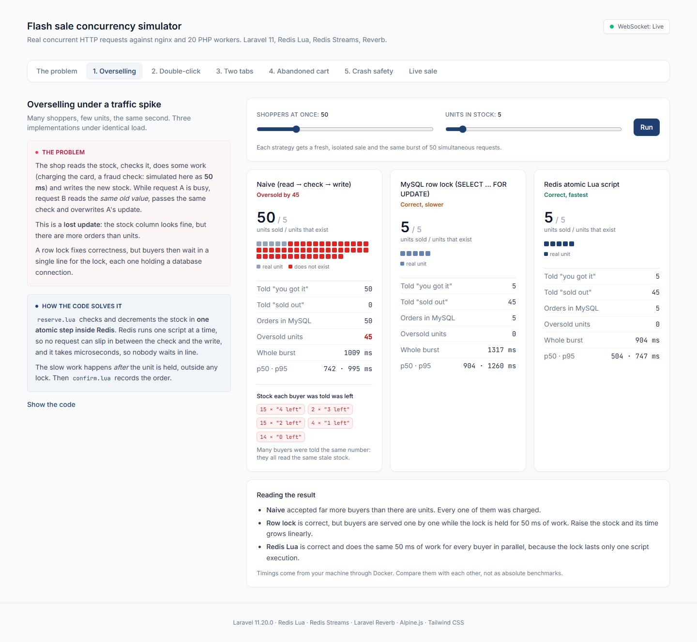

---

## Contents

- [The problem](#the-problem)
- [Do you need this?](#do-you-need-this)
- [What the engine guarantees](#what-the-engine-guarantees)
- [Quick start](#quick-start)
- [Simulator walkthrough](#simulator-walkthrough)
- [Benchmark](#benchmark)
- [How it works](#how-it-works)
- [API](#api)
- [Tests](#tests)
- [Project layout](#project-layout)
- [Going to production](#going-to-production)

---

## The problem

The usual checkout code reads the stock, checks it, and writes it back:

```php
$stock = FlashSale::whereKey($id)->value('stock_remaining');   // 1. read

if ($stock < $quantity) {
    return SoldOut;                                            // 2. check
}

$this->chargeCard();                                           //    slow work

FlashSale::whereKey($id)->update(['stock_remaining' => $stock - $quantity]); // 3. write
Order::create([...]);
```

It looks correct and passes every test with one user. With two users and one unit left:

| Time | Shopper A                   | Shopper B                   | Stock in MySQL |
|------|-----------------------------|-----------------------------|----------------|
| t1   | reads stock: 1              |                             | 1              |
| t2   |                             | reads stock: 1              | 1              |
| t3   | 1 ≥ 1, charges, writes 0    |                             | 0              |
| t4   |                             | 1 ≥ 1, charges, writes 0    | 0              |

Two orders, two charged cards, one console. The stock column says `0`, so nothing looks wrong until
the warehouse cannot ship the second order. This is a **lost update**, and it does not need heavy
traffic: two visitors are enough.

A flash sale makes it worse: thousands of shoppers, a few units, all in the same second. In the
simulator, 50 shoppers racing for 5 units with this code produce **36 to 49 orders**.

## Do you need this?

Honestly, most shops do not.

| Approach                                   | Correct | Under a traffic spike                                         | Use it for                     |
|--------------------------------------------|---------|---------------------------------------------------------------|--------------------------------|
| Read → check → write                       | No      | Oversells. Two visitors are enough.                           | Never                          |
| MySQL row lock / `UPDATE … WHERE stock ≥ ?` | Yes     | Buyers queue on one hot row, each holding a DB connection.    | Everyday e-commerce            |
| **Redis atomic Lua (this engine)**         | Yes     | Check and decrement in microseconds; MySQL written later.     | Flash sales, ticket drops, hot products |

For a normal store, an atomic `UPDATE flash_sales SET stock = stock - 1 WHERE id = ? AND stock >= 1`
is correct and enough. This engine is for **hot-row contention**: many buyers for the *same* product
at the *same* moment, where a database lock turns the sale into a single-file queue.

## What the engine guarantees

| Real-world failure                                   | What the engine does                                                                 |
|------------------------------------------------------|--------------------------------------------------------------------------------------|
| Many shoppers buy the last units at once             | `reserve.lua` checks and decrements stock in one atomic Redis step                    |
| Double-click, network retry                          | `X-Idempotency-Key`: the request runs once, duplicates get the original response replayed |
| Same shopper in two tabs                             | One active reservation per shopper, enforced inside the same Lua script               |
| Shopper reserves and walks away                      | Reservations expire; a once-a-second reclaim returns their units and pushes the change live |
| Server crashes right after payment                   | The order is written to a Redis Stream in the same atomic step as the confirmation; a worker persists it to MySQL and only then acknowledges it |
| Per-customer limit (e.g. 1 per shopper)              | Tracked in Redis across reservations and confirmed orders, rebuilt from MySQL on reload |

## Quick start

Requires Docker. Nothing else is installed on the host.

```bash
cp .env.example .env
docker compose up -d --build                                  # app, nginx, mysql, redis, reverb, scheduler, consumer
docker compose run --rm node                                  # build the frontend once
docker compose exec app php artisan db:seed                   # 200 shoppers, 4 flash sales
docker compose exec app php artisan flash-sale:warmup --all   # load stock into Redis
```

Open **http://localhost:8080**.

| Service              | Address                                        |
|----------------------|------------------------------------------------|
| Simulator            | http://localhost:8080                          |
| Reverb (WebSocket)   | ws://localhost:8081                            |
| MySQL                | `localhost:3307`, user `flash_sale` / `secret` |
| Redis                | `localhost:6380`                               |

Host ports `3307` and `6380` avoid clashing with a local MySQL (XAMPP) or Redis.

| Container   | Role                                                                          |
|-------------|-------------------------------------------------------------------------------|
| `app`       | PHP-FPM with a static pool of **20 workers**: real parallel request handling |
| `nginx`     | HTTP entry point                                                              |
| `reverb`    | WebSocket server for live stock updates                                       |
| `scheduler` | `schedule:work`: runs the reservation reclaim every second                    |
| `consumer`  | `flash-sale:consume-orders`: moves confirmed orders from the stream to MySQL  |
| `mysql`, `redis` | MySQL 8.0, Redis 7.2                                                     |
| `node`      | One-off frontend build (Vite, Tailwind, Alpine, Echo)                         |

## Simulator walkthrough

Each tab is one real failure. The left side explains **the problem** and **how the code solves it**,
with the real source a click away; the right side runs it against the actual server. Every request
is a real HTTP request through nginx to PHP-FPM; bursts are fired server-side with `Http::pool`,
because a browser only opens about six connections per host.

### The problem

An animated replay of the "last unit, two clicks" race, toggled between the naive code and the atomic
Lua script, plus the "do you need this?" comparison.

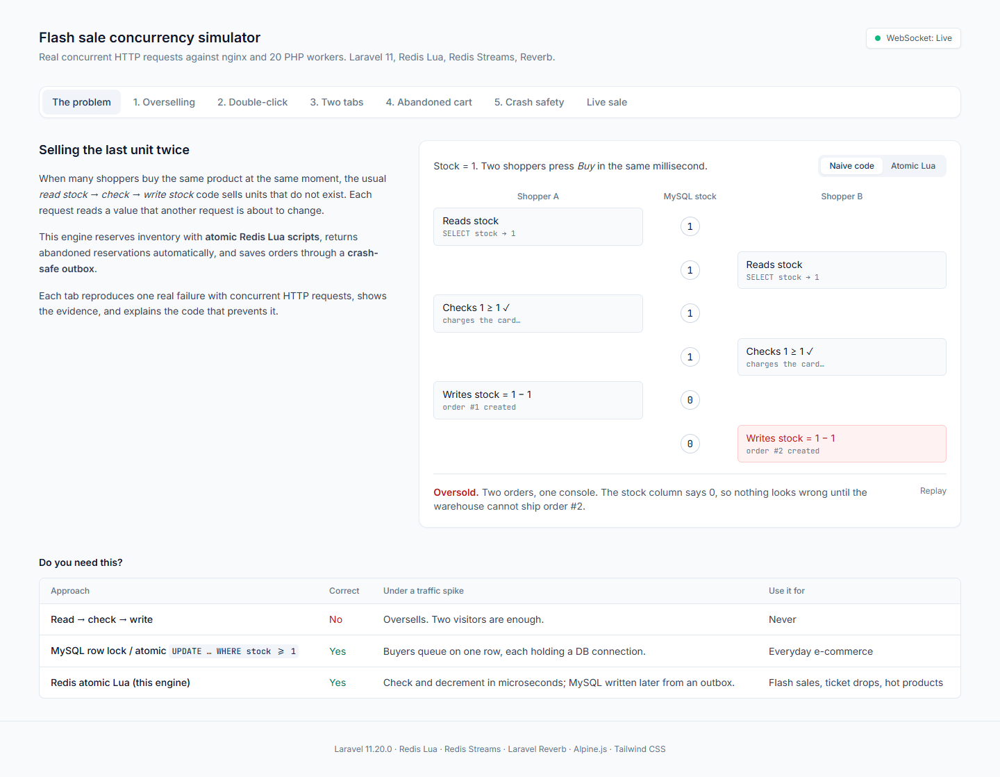

### 1. Overselling

Pick the number of shoppers and units. The same burst hits three implementations, each on a fresh
sale: naive read-check-write, a MySQL row lock (`SELECT … FOR UPDATE`) and the Redis Lua script.
Every strategy does the same 50 ms of simulated per-order work (payment, fraud check).

What to look for:

- **Naive** sells units that do not exist (red squares). The "stock each buyer was told was left"
  list shows many buyers told the same number: they all read the same stale value.
- **Row lock** is correct but serves buyers one by one, because the lock is held during the work.
- **Redis Lua** is correct and as fast as the broken version: the lock lasts one script execution,
  and the slow work happens while the unit is safely reserved.

"Show the code" opens the three implementations and `reserve.lua` in full width under the scenario.

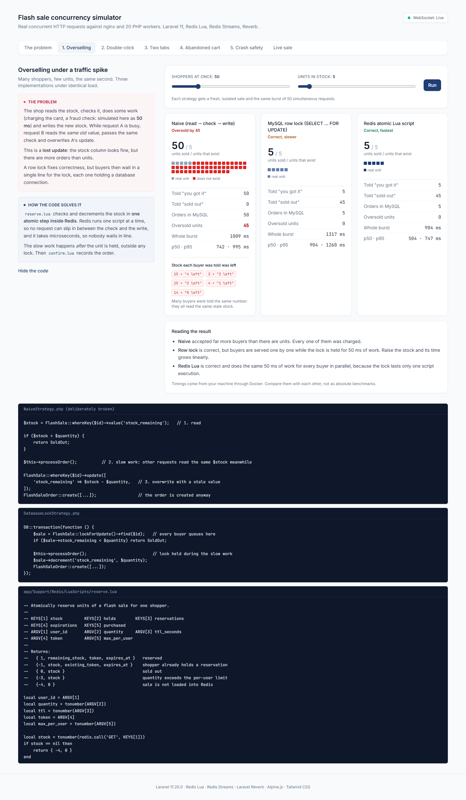

### 2. Double-click

One shopper triple-clicks *Reserve* with the same idempotency key, then retries after the answer,
then a buggy client sends a new key per click.

- First click: `201 reserved`. Concurrent duplicates: `409 request_in_progress`. Later retry: the
  original `201` replayed (`Idempotent-Replayed: true`). Stock drops by exactly one.
- New key per click: `409 already_holding` from the Lua script, the second line of defence.

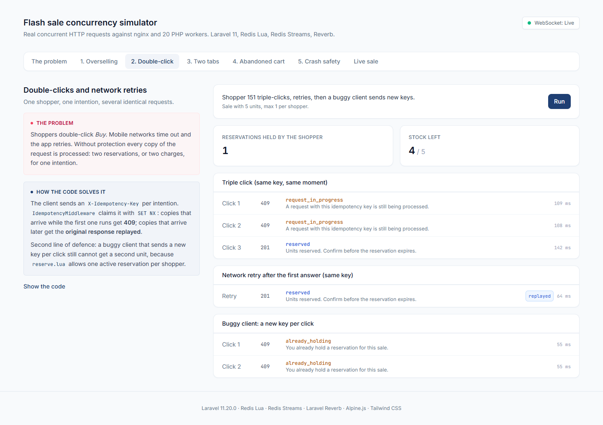

### 3. Two tabs

The same shopper presses *Reserve* in two tabs at once, then *Pay* in both. Different requests,
different keys, one person. One reservation, one order: the per-shopper rule lives inside the same
atomic script as the stock decrement, and `confirm.lua` deletes the reservation as it confirms it.

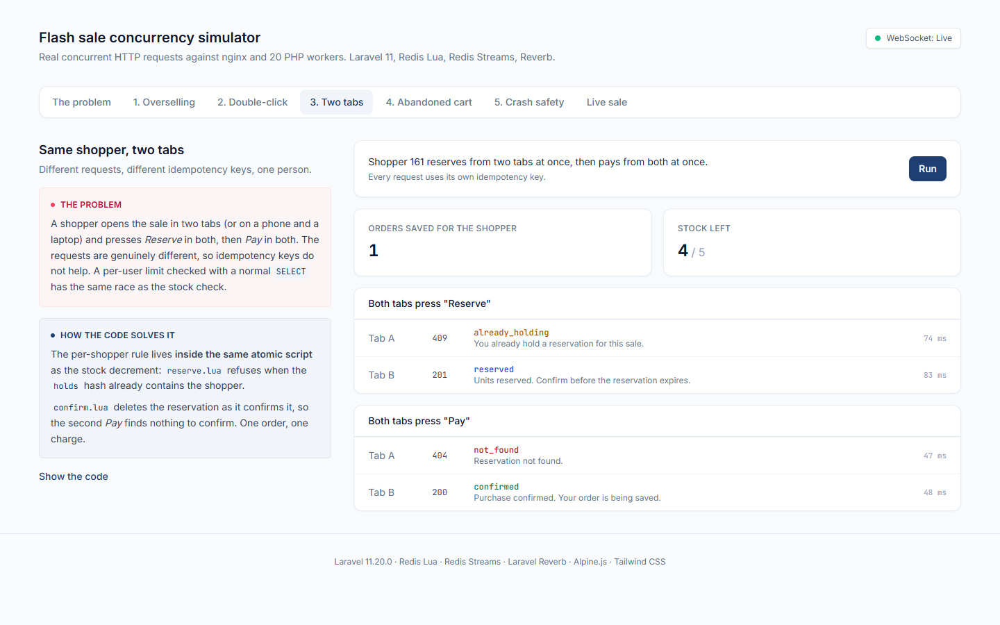

### 4. Abandoned cart

Two shoppers reserve the only two units and leave. A third arrives: sold out. Reservations in this
scenario expire after 10 seconds, the reclaim tick returns the units, the page updates over the
WebSocket without a refresh, and the third shopper buys.

| Held                                                           | Returned and bought                                               |
|----------------------------------------------------------------|-------------------------------------------------------------------|
| 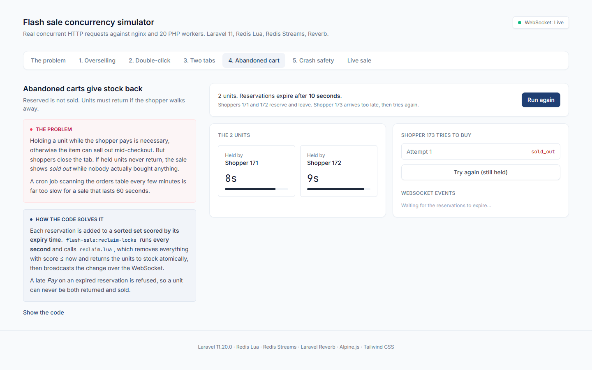        | 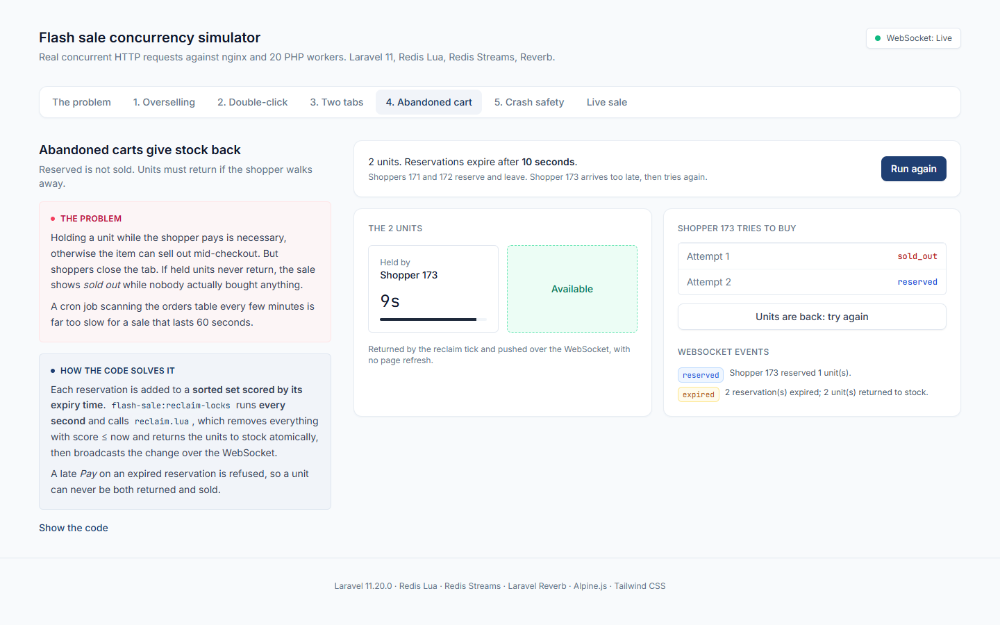   |

### 5. Crash safety

The order worker is stopped (as if it crashed) and a shopper pays. MySQL has no order, yet nothing is
lost: the order waits in the Redis Stream. Restart the worker and it is saved.

| Worker stopped: order waits in the stream                       | Worker back: order saved to MySQL                              |
|-----------------------------------------------------------------|----------------------------------------------------------------|
| 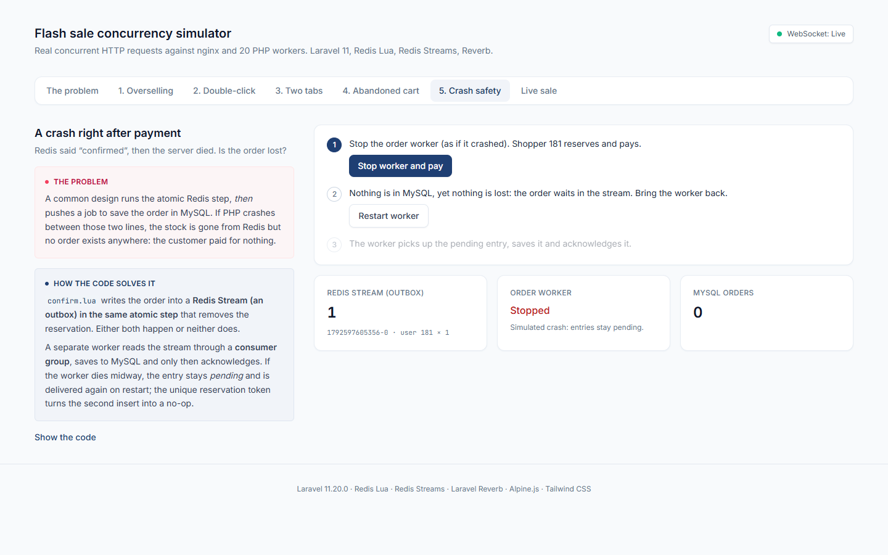    | 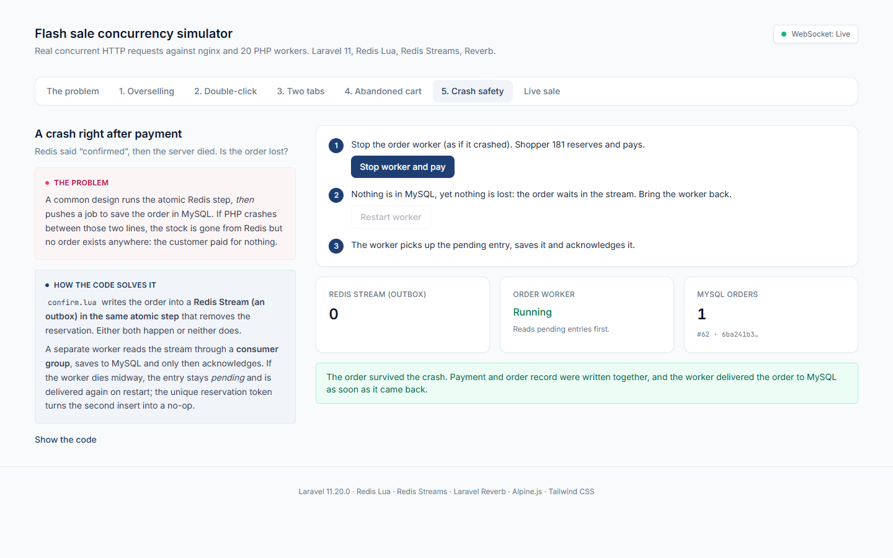 |

### Live sale

Act as any of the 200 seeded shoppers (reserve, pay, cancel) or send a burst. The stock gauge, the
reservation countdowns and the WebSocket event feed update live. Open the page in a second window to
see both update together.

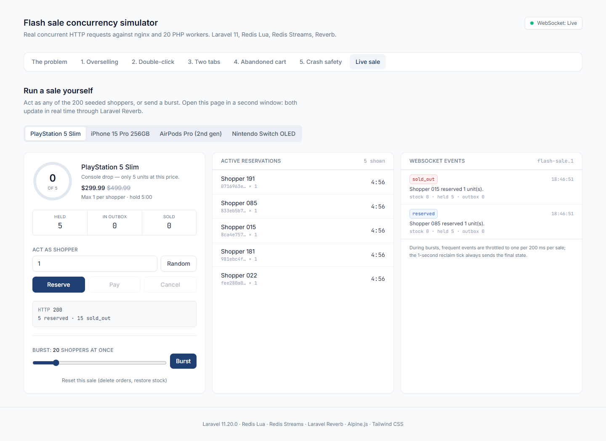

## Benchmark

The overselling scenario, median of 3 runs, 50 ms of simulated work per purchase, 20 PHP-FPM workers,
Docker Desktop on Windows. Compare the strategies with each other, not as absolute numbers.

| Shoppers / units | Strategy   | Units sold | Oversold | Whole burst | p50      | p95      |
|------------------|------------|-----------:|---------:|------------:|---------:|---------:|
| 50 / 5           | Naive      | 49         | **44**   | 944 ms      | 639 ms   | 917 ms   |
|                  | Row lock   | 5          | 0        | 1 437 ms    | 1 007 ms | 1 405 ms |
|                  | Redis Lua  | 5          | 0        | 1 015 ms    | 584 ms   | 886 ms   |
| 100 / 50         | Naive      | 100        | **50**   | 1 787 ms    | 941 ms   | 1 718 ms |
|                  | Row lock   | 50         | 0        | 4 553 ms    | 3 604 ms | 4 438 ms |
|                  | Redis Lua  | 50         | 0        | 1 980 ms    | 1 099 ms | 1 884 ms |
| 200 / 100        | Naive      | 200        | **100**  | 3 560 ms    | 1 811 ms | 3 288 ms |
|                  | Row lock   | 100        | 0        | 8 721 ms    | 6 923 ms | 8 560 ms |
|                  | Redis Lua  | 100        | 0        | 3 677 ms    | 2 110 ms | 3 431 ms |

How to read it:

- **Naive** oversold in every run (36 to 49 orders for 5 units in the smallest case).
- **Row lock** time grows with the number of *units sold*: each sale holds the row for its 50 ms of
  work, so 100 units take at least 5 seconds no matter how many workers you add.
- **Redis Lua** time grows only with the number of *requests per worker* (200 requests / 20 workers
  × 50 ms ≈ 0.5 s of pure work, plus overhead). It stays within a few percent of the broken naive
  version while being correct. More workers or servers make it faster; they cannot speed up a row lock.

Reproduce with the simulator, or:

```bash
curl -X POST http://localhost:8080/api/simulations/race \
     -H 'Content-Type: application/json' -d '{"shoppers": 200, "stock": 100}'
```

## How it works

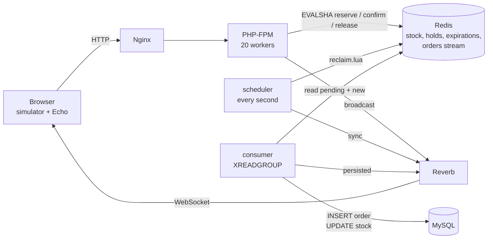

A purchase is two short atomic steps with the slow work in between:

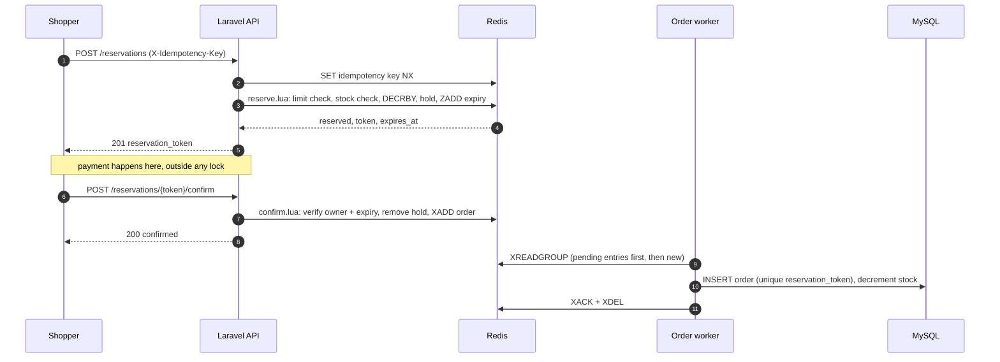

Key ideas:

- **Redis is the source of truth for stock during a sale.** MySQL is updated asynchronously from the
  stream; `flash-sale:warmup` loads a sale's remaining stock into Redis before it opens.
- **All decisions happen inside Lua.** Redis runs one script at a time, so "check then act" cannot
  interleave. Time comes from `redis.call('TIME')`, never from PHP, so every server agrees on expiry.
- **The outbox is part of the confirmation.** There is no gap between "Redis says confirmed" and
  "the order exists somewhere durable"; the consumer retries until MySQL has it, and the unique
  reservation token makes a redelivery harmless.
- **Live updates are throttled.** A burst of 1 000 reservations sends one broadcast per 200 ms per
  sale; the reclaim tick always sends the final state.

The full design, key layout, script return codes and failure analysis are in
[docs/architecture.md](docs/architecture.md).

## API

Shoppers are identified by the `X-User-Id` header (a demo stand-in for authentication). Unsafe
requests require an `X-Idempotency-Key` of 8 to 100 characters.

| Method   | Endpoint                                              | Purpose                                     |
|----------|-------------------------------------------------------|---------------------------------------------|
| `GET`    | `/api/flash-sales`                                    | Live sales with Redis stock                 |
| `GET`    | `/api/flash-sales/{sale}`                             | Redis and MySQL state, active reservations  |
| `POST`   | `/api/flash-sales/{sale}/reservations`                | Reserve (`{"quantity": 1}`), idempotent     |
| `POST`   | `/api/flash-sales/{sale}/reservations/{token}/confirm`| Pay: confirm into the outbox, idempotent    |
| `DELETE` | `/api/flash-sales/{sale}/reservations/{token}`        | Cancel and return the units                 |
| `POST`   | `/api/lab/flash-sales/{sale}/purchase/{strategy}`     | One purchase with `naive`, `db_lock` or `redis_lua` |

```bash
curl -X POST http://localhost:8080/api/flash-sales/1/reservations \
     -H 'X-User-Id: 42' -H 'X-Idempotency-Key: 3f6c1d2e-reserve' -H 'Accept: application/json'
```

```json
{
  "status": "reserved",
  "message": "Units reserved. Confirm before the reservation expires.",
  "available_stock": 4,
  "reservation_token": "0f8f6b0e-8c61-4d1f-9a3e-6f0a4f8b2c11",
  "expires_at": 1723907755,
  "quantity": 1
}
```

| Status | `status` field                                 | Meaning                                         |
|--------|------------------------------------------------|-------------------------------------------------|
| 201    | `reserved`                                     | Units held until `expires_at`                   |
| 200    | `confirmed`, `released`                        | Paid (order queued) / cancelled                 |
| 409    | `sold_out`, `already_holding`, `request_in_progress` | No stock / one hold per shopper / duplicate still running |
| 410    | `expired`                                      | Reservation timed out; its units are returned   |
| 404    | `not_found`                                    | No such reservation for this shopper            |
| 422    | `limit_reached`, `sale_closed`, `idempotency_key_reused` | Per-shopper limit / sale not running / key reused with another payload |

WebSocket: public channel `flash-sale.{sale}`, event `.inventory.updated` with `available_stock`,
`active_reservations`, `pending_orders`, `event_type` and a human-readable `message`.

Artisan commands:

| Command                                   | Purpose                                                       |
|-------------------------------------------|---------------------------------------------------------------|
| `flash-sale:warmup {sale?*} --all --force`| Load stock into Redis; refuses while reservations are held    |
| `flash-sale:reclaim-locks --limit=`       | Return expired reservations (scheduled every second)          |
| `flash-sale:consume-orders --once`        | Persist the outbox stream to MySQL (runs in `consumer`)       |

## Tests

```bash
docker compose exec app ./vendor/bin/pest
```

48 Pest tests against **real Redis and real MySQL** (Redis database 15 and a separate
`flash_sale_testing` database, so the demo data is never touched).

- **Concurrency suite:** 20 separate PHP processes are started and released at the same instant
  against 5 units. Exactly 5 reservations succeed and stock never goes below zero; the Redis Lua
  flow ends with exactly 5 orders in MySQL from 5 different shoppers; the row lock sells exactly 5;
  and the naive strategy is proven to oversell under the same load.
- **Idempotency:** replayed responses, `409` while in progress, `422` for a reused key, keys scoped
  per shopper, a retried payment confirms once.
- **Lock recovery:** expired reservations return their stock, an expired reservation cannot be
  confirmed, reclaim works in bounded batches.
- **Outbox:** orders persisted and acknowledged, an order received by a crashed worker is recovered
  from the pending list, a redelivered order is not saved twice.
- **Reservation API, warmup guard, per-shopper limit rebuild, Lua `NOSCRIPT` fallback.**

If your MySQL volume existed before the test database was added, create it once:

```bash
docker compose exec -T mysql mysql -uroot -proot < docker/mysql/init/01-testing-database.sql
```

## Project layout

```
app/
├── Console/Commands/          warmup, reclaim-locks, consume-orders
├── Events/InventoryUpdated    WebSocket payload (ShouldBroadcastNow)
├── Http/Middleware/           ResolveShopper (X-User-Id), IdempotencyMiddleware
├── Services/FlashSale/
│   ├── InventoryLockService   reserve / confirm / release / reclaim / snapshot
│   ├── InventoryBroadcaster   throttled broadcasts + final-state sync
│   ├── OrderPersister         idempotent stream → MySQL write
│   └── Strategies/            naive, db_lock, redis_lua (the comparison)
├── Services/Simulation/       scenario runner behind the simulator
└── Support/Redis/
    ├── FlashSaleKeys          key layout with {sale} hash tags
    ├── LuaScriptRunner        EVALSHA with NOSCRIPT fallback
    └── LuaScripts/            reserve, confirm, release, reclaim
resources/views/simulator/     one Blade view per tab
tests/Concurrency/             multi-process race tests + worker
docker/                        php-fpm, nginx, mysql init
```

## Going to production

This is a demonstration project; these are the parts a real deployment would change.

- **Authentication:** replace the `X-User-Id` header with Sanctum; the middleware is the only place
  that reads it.
- **Redis durability:** enable AOF (`appendonly yes`, `appendfsync everysec`) and replication. Redis
  holds the stock and the not-yet-persisted orders during a sale.
- **Redis Cluster:** every key of a sale shares the `{sale_id}` hash tag, so the multi-key scripts
  already run in a single slot.
- **Scale:** add PHP workers or servers; the hot path never touches MySQL. Run more `consumer`
  processes with distinct `--consumer` names to persist faster.
- **Simulator:** disable it with `FLASH_SALE_SIMULATOR=false`; its endpoints create and reset sales.

## Stack

| Component       | Version                                       |
|-----------------|-----------------------------------------------|
| PHP (FPM)       | 8.3 with phpredis                             |
| Laravel         | 11.20                                         |
| Laravel Reverb  | 1.x                                           |
| Pest            | 2.x                                           |
| MySQL           | 8.0                                           |
| Redis           | 7.2                                           |
| Frontend        | Vite 5, Tailwind CSS 3, Alpine.js 3, Laravel Echo |

## License

MIT
