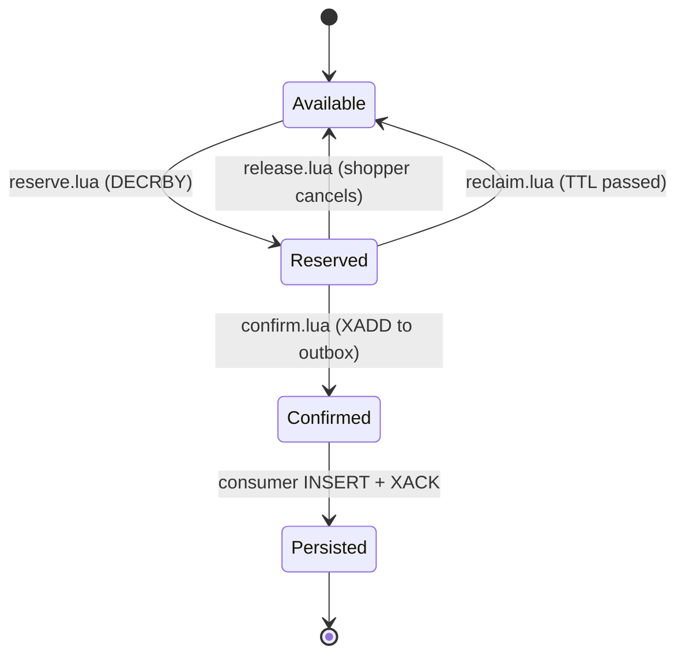
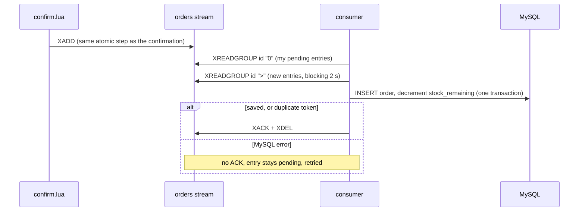
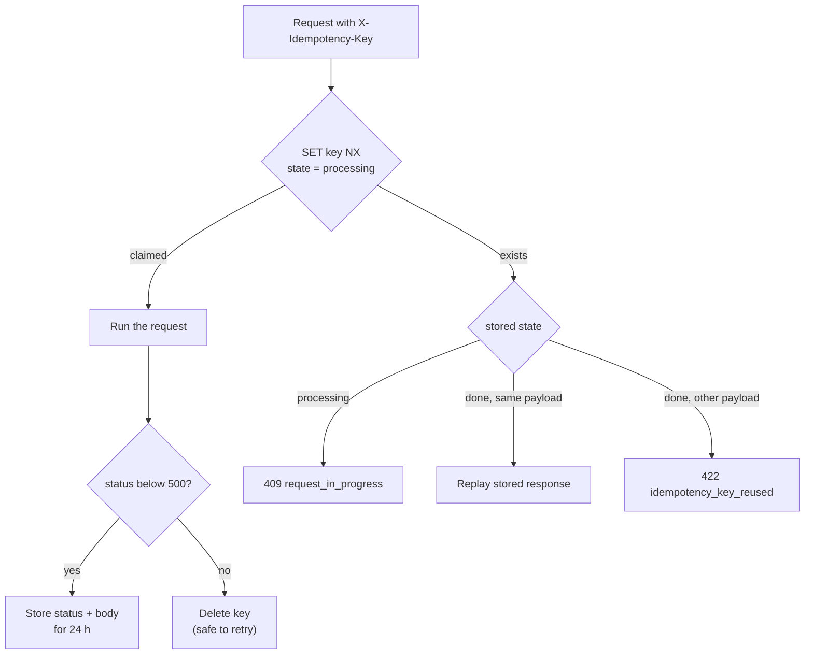

# Architecture

This document explains how the engine keeps a flash sale correct under concurrency: where the
state lives, what each atomic step does, and what happens when a component fails. For setup and
the simulator, see the [README](../README.md).

- [Components](#components)
- [Where the state lives](#where-the-state-lives)
- [Redis key layout](#redis-key-layout)
- [Lua scripts](#lua-scripts)
- [Lifecycle of a purchase](#lifecycle-of-a-purchase)
- [The order outbox](#the-order-outbox)
- [Idempotency](#idempotency)
- [Live updates](#live-updates)
- [Failure analysis](#failure-analysis)
- [Design decisions](#design-decisions)

## Components

| Component              | Code                                              | Responsibility                                              |
|------------------------|---------------------------------------------------|-------------------------------------------------------------|
| Reservation API        | `ReservationController`, `routes/api.php`         | Reserve, confirm, release over HTTP                         |
| Shopper resolution     | `ResolveShopper`                                  | Demo identity from `X-User-Id` (cached existence check)     |
| Idempotency            | `IdempotencyMiddleware`                           | Run each unsafe request once, replay its response           |
| Inventory engine       | `InventoryLockService`, `LuaScriptRunner`, `LuaScripts/*.lua` | Every stock decision, atomically inside Redis |
| Sale settings cache    | `FlashSaleRepository`                             | Sale rules read from cache, so the hot path skips MySQL     |
| Reclaim                | `flash-sale:reclaim-locks` (every second)         | Return units of expired reservations                        |
| Outbox consumer        | `flash-sale:consume-orders`, `OrderPersister`     | Move confirmed orders from the Redis Stream to MySQL        |
| Broadcasting           | `InventoryBroadcaster`, `InventoryUpdated`, Reverb | Push stock changes to browsers                             |
| Strategy lab           | `Strategies/*`, `StrategyLabController`           | Naive and row-lock implementations, for comparison only     |
| Simulator              | `SimulationRunner`, `SimulationController`, Blade views | Reproduce each failure with real concurrent requests |

## Where the state lives

| Data                                   | During the sale             | Afterwards                         |
|----------------------------------------|-----------------------------|------------------------------------|
| Available stock                        | **Redis** (source of truth) | MySQL `stock_remaining`, updated by the consumer |
| Who holds which units, until when      | Redis only                  | Gone (expired or confirmed)        |
| Confirmed, not yet saved orders        | Redis Stream                | Removed once saved and acknowledged |
| Orders                                 | MySQL (via the consumer)    | MySQL                              |
| Units bought per shopper (limit)       | Redis, rebuilt from MySQL on load | MySQL                        |
| Sale rules (price, limit, TTL, window) | MySQL, cached               | MySQL                              |

`flash-sale:warmup` copies a sale's remaining stock into Redis before it opens. It refuses to reload a
sale that has active reservations or unsaved orders (unless `--force`), never clears the orders
stream, and rebuilds the per-shopper counts from MySQL **plus** any orders still in the stream.

## Redis key layout

Every key of one sale contains the hash tag `{sale_id}`, so in Redis Cluster they all land in the
same slot, which multi-key Lua scripts require. Keys are per sale rather than per product, so one
product can run several sales.

| Key                                  | Type   | Content                                         |
|--------------------------------------|--------|-------------------------------------------------|
| `flash_sale:{id}:stock`              | string | Units available to reserve                      |
| `flash_sale:{id}:holds`              | hash   | `user_id → token`: one active hold per shopper  |
| `flash_sale:{id}:reservations`       | hash   | `token → "user_id\|quantity"`                   |
| `flash_sale:{id}:expirations`        | zset   | `token`, scored by expiry (unix seconds)        |
| `flash_sale:{id}:purchased`          | hash   | `user_id → units confirmed` (per-shopper limit) |
| `flash_sale:{id}:orders`             | stream | Confirmed orders waiting for MySQL (outbox)     |
| `flash_sale:{id}:broadcast_throttle` | string | `SET NX PX 200` flag limiting broadcasts        |
| `flash_sale:{id}:broadcast_state`    | string | Last state sent to WebSocket clients            |
| `flash_sale:active`                  | set    | Sale ids loaded into Redis                      |

Two rules keep the scripts correct:

- **Keys are always passed in `KEYS[]`**, never built inside Lua. phpredis applies `REDIS_PREFIX` to
  `KEYS[]` only; a key assembled in Lua would silently miss the prefix.
- **Time comes from `redis.call('TIME')`** inside the script. With several PHP servers, their clocks
  can disagree; Redis is the single clock every expiry is measured against.

## Lua scripts

Redis executes one script at a time, from start to finish. A script is therefore a lock that lasts
only microseconds, and no other request can observe or change the state halfway through.

`LuaScriptRunner` calls `EVALSHA` with a per-process SHA cache and falls back to `EVAL` (which also
caches the script on the server) when Redis answers `NOSCRIPT`, for example after a restart.

### `reserve.lua`

Checks, in order: sale loaded, shopper not already holding, per-shopper limit, stock. Then
`DECRBY` stock, records the hold, the reservation and its expiry.

| Returns                                   | Meaning                         | HTTP |
|-------------------------------------------|---------------------------------|------|
| `{1, remaining, token, expires_at}`       | Reserved                        | 201  |
| `{-1, stock, existing_token, expires_at}` | Shopper already holds a reservation | 409 |
| `{0, stock}`                              | Sold out                        | 409  |
| `{-3, stock}`                             | Over the per-shopper limit      | 422  |
| `{-4, 0}`                                 | Sale not loaded into Redis      | 503  |

### `confirm.lua`

Verifies the token belongs to this shopper and has not expired, removes the hold, the reservation
and the expiry, adds the units to the shopper's purchased count and **`XADD`s the order to the
stream**, all in the same step.

| Returns                              | Meaning                                     | HTTP |
|--------------------------------------|---------------------------------------------|------|
| `{1, quantity, stream_id, stock}`    | Confirmed; order is in the outbox           | 200  |
| `{-2, stock}`                        | No such reservation for this shopper        | 404  |
| `{-5, stock}`                        | Expired; reclaim will return the units      | 410  |

The expiry check matters: without it, a shopper could pay a second after the reclaim decided to
return the unit, and the same unit would be both back in stock and sold.

### `release.lua`

The shopper cancels: removes the reservation and `INCRBY`s the stock. `{1, quantity, stock}` or
`{-2, stock}` when the token is not theirs.

### `reclaim.lua`

`ZRANGE expirations -inf now BYSCORE LIMIT 0 N` finds expired tokens, removes their hold and
reservation, and returns their units with one `INCRBY`. The batch limit (`FLASH_SALE_RECLAIM_BATCH`,
default 500) keeps each run short so Redis is never blocked; the next tick continues. Returns
`{expired, units_reclaimed, stock, active_reservations}`.

## Lifecycle of a purchase

A unit leaves `Reserved` exactly once: release, reclaim and confirm each remove the reservation in
their own atomic step, and the other two then find nothing to act on.

The slow part of a real checkout (payment authorisation, fraud checks) happens while the unit is
`Reserved`, **outside any lock**. That is the difference with a row lock, which holds the lock for the
whole transaction including that work.

## The order outbox

A common design runs the Redis step, then dispatches a queued job to write the order. If PHP dies
between the two lines, Redis has sold the unit and no order exists anywhere. Here the order is
written to a Redis Stream **inside** `confirm.lua`, so "confirmed" and "order recorded" cannot be
separated.

- **Pending first.** The consumer has a stable name (`--consumer=persister-1`). On start it reads id
  `0`: entries delivered to it before a crash and never acknowledged. Only then does it read new ones.
- **At-least-once delivery, exactly-once effect.** `reservation_token` is unique in
  `flash_sale_orders`, so a redelivered entry hits the constraint and is acknowledged as a duplicate.
- **Acknowledge after the commit.** `XACK` + `XDEL` run only after MySQL committed.
- **Deleted streams.** If a sale is reset while the consumer is blocked, Redis answers `NOGROUP`; the
  consumer recreates its groups on the next pass.
- **Pause switch.** The simulator sets `flash_sale:consumer:paused` to stop the consumer as if it
  crashed: entries already read stay pending, exactly like a real crash.

## Idempotency

`IdempotencyMiddleware` wraps reserve and confirm.

- The storage key hashes shopper, method, path and the client key, so keys are scoped per shopper
  and per endpoint.
- The payload fingerprint stops a client from reusing a key for a different request.
- The `processing` state expires after 60 s, so a request that died mid-flight does not block the
  key forever.
- Idempotency handles *the same intention sent twice*. Two *different* intentions from the same
  shopper (two tabs, a buggy client with a new key per click) are stopped by the one-hold-per-shopper
  rule inside `reserve.lua`.

## Live updates

`InventoryUpdated` implements `ShouldBroadcastNow` (no queue hop) on the public channel
`flash-sale.{id}` as `.inventory.updated`.

- `reserved`, `confirmed` and `persisted` are high-frequency: at most one broadcast per sale per
  200 ms (`SET NX PX`). A burst of 1 000 reservations is a handful of messages, not 1 000.
- `released`, `expired` and `sold_out` are always sent.
- The reclaim tick calls `sync()` every second, which broadcasts the current state only if it differs
  from the last one sent. Whatever the throttle skipped, clients converge within a second.
- A broadcast failure is reported and swallowed: Reverb being down never fails a purchase.

## Failure analysis

| What fails                                   | Effect                                                     | Why it is safe                                         |
|----------------------------------------------|------------------------------------------------------------|--------------------------------------------------------|
| PHP dies after `reserve.lua`, before replying | The unit is held for its TTL                              | The retry sees `already_holding` with the same token, or the hold expires and the unit returns |
| PHP dies after `confirm.lua`, before replying | Order is in the stream; the client got no answer           | The order is saved by the consumer. A retry after the 60 s processing window gets `not_found`, so a real client should check its order status rather than pay again |
| Consumer dies before `XACK`                  | Entry stays pending                                        | Read again on restart (pending first); unique token prevents a duplicate |
| MySQL is down                                | Sales continue; orders accumulate in the stream            | Consumer retries every second; no ACK until committed  |
| Scheduler is down                            | Expired reservations keep their units out of stock         | They cannot be confirmed (expiry check in `confirm.lua`); stock returns when reclaim runs again |
| Reverb is down                               | Browsers stop receiving updates                            | Purchases are unaffected; clients catch up on the next broadcast after reconnecting |
| Redis is down                                | Reservations fail                                          | The engine fails closed: it cannot oversell without Redis. Durability of in-flight state depends on Redis persistence (see below) |
| Redis restarts without persistence           | Holds and unsaved orders are lost                          | Not safe: production needs AOF (`appendonly yes`) and a replica |
| Two shoppers, last unit, same millisecond    | One gets it, one gets `sold_out`                           | Redis runs one script at a time                        |

## Design decisions

**Lua instead of `WATCH`/`MULTI` or a distributed lock.** Optimistic `WATCH` transactions retry under
contention, which is exactly a flash sale; a Redlock-style lock adds round trips and still needs
fencing. A Lua script is atomic by construction and costs one round trip.

**A reservation step instead of decrement-and-done.** Real checkouts take seconds. Holding a unit
with a TTL lets payment happen outside any lock, and lets abandoned carts give stock back.

**A sorted set for expiries.** Redis key expiry cannot run code when a hold ends (keyspace
notifications are fire-and-forget). A ZSET scored by expiry gives an ordered, batchable list of
exactly what to reclaim.

**A Redis Stream instead of a queued job.** A job dispatch is a second write after the Lua script
and can be lost in between. `XADD` inside the script makes the outbox part of the confirmation, and
consumer groups give pending-entry recovery for free.

**Per-sale keys with hash tags.** Multi-key scripts must run on one cluster slot; the `{sale_id}`
tag guarantees it, and keying by sale lets one product run several sales.

**Settings from cache, not MySQL.** The reservation path reads sale rules from cache and stock from
Redis, so a spike never reaches the database until orders are persisted at the consumer's pace.

**PHP-FPM, not Octane.** Octane increases throughput by keeping the app booted, but correctness here
comes from Redis atomicity, not from the PHP runtime. A static FPM pool of 20 workers gives real
parallel requests, which is what the simulator needs to show the races.

**Same simulated work for every strategy.** The strategy lab gives naive, row-lock and Lua the same
50 ms of per-order work, so the comparison measures only how long each one holds its lock.
